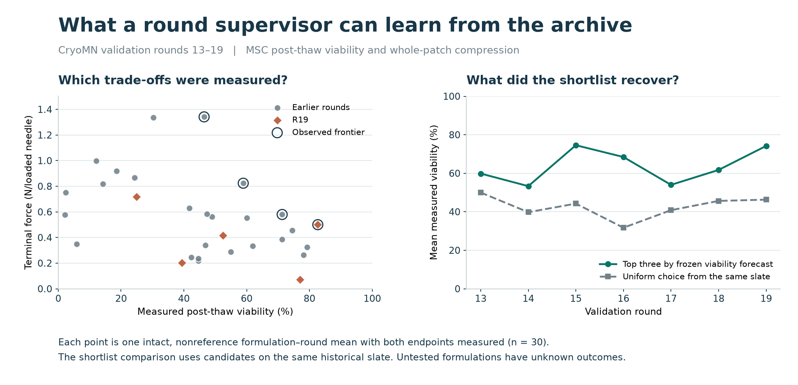

# An agent-supervised CryoMN project

Give the supervisor a scientific question and a fixed experimental budget. After each human validation, it should decide **which uncertainty is worth spending the next mechanical test on**. In this campaign that can mean measuring a viable formulation for the first time, confirming a promising trade-off in a separately prepared batch, or leaving the slot with the optimizer. Each choice displaces another experiment.

The prototype replays seven full-mechanics rounds, issues a brief for the pending round and produces a separate draft slate for a new project. The lab’s existing selector supplies the historical candidate slates. The supervisor contributes question selection, slot allocation, challenge and follow-up. Read the numerical record and the example four-slot brief in the [round decisions](replay.md).

The [visual guide and round explorer](visuals/index.html) contains eight schematics and fifteen data plots. It follows each round’s evidence from the frozen forecasts to the next experimental question and shows how two archived compression traces produce one measured force value. The [bookmarked PDF](visuals/CryoMN_visual_guide.pdf) also works as a standalone copy. Rebuild both from the project root with `python3 -m research.round_supervisor.visuals.build`. The PDF step uses ReportLab and pypdf. Use `--pdf-python PATH` to choose their interpreter.



The [spoken findings](findings_read_aloud.m4a) compare the original optimizer, the rule-based supervisor, and the scientist–critic review. The [transcript](findings_read_aloud.md) includes the matched first-choice counts, the Round 15 candidate the original selector prioritized, and the evidence still needed to measure the agents’ contribution.

## What the researcher delegates

At project creation, record the cell and assay context, permitted formulation space, material availability, endpoint versions, budget, controls and any application thresholds. For the example, maximize post-thaw mesenchymal stromal cell (MSC) viability in percent and whole-patch terminal compression force in N per loaded needle. The mechanical value is recorded at 0.8 mm displacement after a sustained 1 N trigger. Only an intact patch with both measurements in the same batch contributes to the observed trade-off. The present archive has no defined application minima. A fracture threshold or insertion claim would require its own measurement and definition. [Endpoint configuration](../../config_v2/endpoints.yaml) · [Terminal-force implementation](../../src/08_multi_objective/helper/terminal_force.py)

The researcher runs the bench work, supplies a completed worksheet and the corresponding readouts, and marks a submission ready for validation. The intended routine loop then runs automatically under the project charter. An explicit staging-only submission ends at validation. A conflicting sample identity, changed assay, change in objectives, or increase in authorized experimental capacity goes back to the researcher with the single decision needed.

## How a round runs

| Step and owner | What it does automatically | What the next step receives |
|---|---|---|
| 1. Project supervisor | Tracks the two objectives, assay versions, phase, slots, outstanding questions and stopping conditions. At project start it asks the lab for any material decision still missing. | A versioned project charter and an initial design brief. |
| 2. Evidence agent | Retrieves primary papers and preprints. Records the specific claim, source, assay or material studied, and what assumption would be needed to transfer the finding. Refreshes when a new question warrants it. | A short evidence record linked to each proposed hypothesis. |
| 3. Design agent and numerical selector | Apply inventory, feasibility, diversity and repeat limits. Reserve controls and approved question-driven slots. Use the numerical optimizer for the remaining places. Record the runner-up displaced by each special slot. | A frozen, budgeted proposal with composition, role, predictions, intervals, test priority and ordered backups. |
| 4. Researcher and intake agent | The lab returns its observations. The intake agent matches proposal, batch, formulation, specimen, preparation, readout, trace and loaded-needle count. It validates units, missingness, formation and endpoint definition. | A completed, attested results bundle bound to the frozen proposal. Ambiguous rows carry an explicit issue. |
| 5. Evaluation agent | Scores the frozen forecasts before refitting. Computes within-round ranking, absolute error, interval coverage and width, shortlist lift, formation failures, paired outcomes and cumulative Pareto progress. Tracks reference behavior and missing compression separately. | A numeric evidence packet with denominators, comparison cohorts and unresolved measurements. |
| 6. Scientist and independent critic | The scientist proposes a falsifiable question, an alternative explanation and a decision for each outcome. The critic checks that the planned measurements can distinguish the explanations. Both see the same dated evidence. | An accepted research question, a revision, or the versioned default decision. |
| 7. Supervisor | Closes answered questions, carries unanswered ones, chooses the next allocation and freezes it before the next results arrive. It records which outcomes would change direction. | The researcher’s next worksheet and a short explanation of what the round is designed to learn. |

**Cold start.** In a fresh project, begin with a reference, repeats that identify within- and between-batch variation, and a space-filling design over the lab-approved material space. Transfer earlier viability measurements with explicit source and noise labels. Keep mechanically incompatible legacy measurements out of the primary endpoint. Progress from screening to a small paired-mechanics bootstrap, then to joint optimization when enough distinct formulations and batches have both endpoints. The repository already records phase gates and a noise-aware acquisition implementation. The replay starts at full mechanics because that is where both objectives can be evaluated prospectively on comparable forecasts. [Phase and selection configuration](../../config_v2/optimization.yaml) · [Existing candidate selector](../../src/08_multi_objective/02_select_candidates/README.md)

**Routine decision policy.** Score both objectives separately and retain the nondominated measured points. A formulation is dominated when another is at least as good on both endpoints and better on one. Use a fixed reference point to track the area covered by the measured frontier. For scarce force measurements, the prototype gives first priority to the most viable intact formulation lacking a force result in the latest round. It ranks exact-repeat requests by the viability of frontier members measured jointly in only one replayed round. If every previous primary patch passed formation, it can reserve a second mechanical slot for that repeat. After a primary formation failure it preserves the remaining optimizer slots and ordered backups. These are inspectable design choices made for this prototype. A new charter can change them prospectively.

The current project provides concrete starting gates. Mechanical entry waits for eight completed screening rounds. Its hybrid gate requires eight paired observations, six distinct formulations and two batches. Full mechanics requires 16 paired observations, 12 distinct formulations and three batches. For a new project, choose and freeze these counts against the assay budget. The shortlists and error bands also need separate checks. Across R13–19, proposal-time viability intervals covered 65/77 observations at a mean width of 52.51 percentage points. The archived future-batch intervals covered 70/77 at a mean width of 73.15 points. A supervisor quoting an uncertainty band should say which future quantity it describes. [Phase configuration](../../config_v2/optimization.yaml) · [Interval diagnostics](../../results/multi_objective_v2/reports/prospective/tables/interval_scores.csv)

**What changes the decision.** If an intact screened hit adds a measured trade-off, retain it on the observed frontier and ask whether an independent preparation reproduces it. If an earlier point matches or exceeds both means, move the next discretionary slot to another candidate. When a candidate fails formation, record that batch’s failure and promote an eligible ordered backup. When the lab omits a measurement, keep the joint question open. A proposal to attribute a change to a particular ingredient needs a matched comparison that isolates the ingredient. A change in a batch mean alone supports a follow-up question.

**Stopping and escalation.** End discovery at the agreed budget, or move to confirmation when a frontier member meets application targets declared in advance. The charter should specify independent preparations or cell lots, reproducibility margins, and the strength of evidence needed to declare success. With targets unset, the supervisor can report measured trade-offs and recommend confirmation. If the budget expires there, the output is a frontier with open questions. If the frontier stalls while force evidence remains sparse, allocate the next available test to that evidence gap before declaring diminishing returns.

## Why these design choices are grounded in the literature

I interpreted the requested cutoff as a **2025 two-year Journal Impact Factor above 20** for journal articles. The publisher reports **56.1 for Nature** and **26.3 for Nature Biomedical Engineering**. The arXiv papers below are identified by version or subsequent conference status. [Nature metrics](https://www.nature.com/nature/journal-impact) · [Nature Biomedical Engineering metrics](https://www.nature.com/natbiomedeng/journal-impact)

| Primary evidence | Inference for this system |
|---|---|
| Chang et al., *Nature Biomedical Engineering* (2021), studied cell-bearing cryomicroneedles and reported post-delivery cell viability and proliferation in their experimental system. [Primary paper](https://pubmed.ncbi.nlm.nih.gov/33941895/) | Define the specific biological readout alongside mechanical characterization. Transfer a paper’s claim only to the endpoint and context it measured. The present MSC archive supports post-thaw viability and bench compression. |
| Attia et al., *Nature* (2020), used ML and adaptive allocation to investigate 224 battery charging protocols and ran a separate validation experiment. [Primary paper](https://www.nature.com/articles/s41586-020-1994-5) | Use a scarce experimental budget adaptively. Reserve independent confirmation for candidates singled out by the search, since selection changes which designs are measured. |
| Boiko et al., *Nature* (2023), connected an LLM to search, documentation, computation and experimental tools and demonstrated multistep chemical research tasks. [Primary paper](https://pubmed.ncbi.nlm.nih.gov/38123806/) | Give each role typed tools and named outputs. In CryoMN, a numerical tool parses the instrument trace and a separate tool commits a validated round. The language agent requests those operations through the supervisor. |
| Gottweis et al., *Nature* (2026), developed a goal-conditioned multi-agent system for generating and iteratively critiquing hypotheses, with experimental evaluation for selected hypotheses. [Primary paper](https://pubmed.ncbi.nlm.nih.gov/42156544/) | Separate proposing a question from judging whether the available experiment can answer it. Require a rival explanation, an observable discriminator and a consequence for the next allocation. |
| Daulton et al. (2021, arXiv version of NeurIPS work) develop noisy expected hypervolume improvement for batched, competing objectives. Ament et al. (2023, arXiv version of NeurIPS work) address numerical pathologies in expected-improvement acquisitions. [Daulton et al.](https://arxiv.org/abs/2105.08195) · [Ament et al.](https://arxiv.org/abs/2310.20708) | Use the existing constrained, log-space noisy hypervolume selector for model-driven slots. Keep posterior uncertainty, the observed frontier and biological evidence separate in the record. |
| Takahara et al., SynAgent (arXiv preprint, September 2026), report deliberately testing conditions predicted to verify and falsify hypotheses during a thin-film materials campaign. [Preprint](https://arxiv.org/abs/2609.18598v1) | Pair a proposed explanation with an observation that would weaken it. This is a design analogy from thin films. Its efficacy in CryoMN requires a prospective comparison. |

## What the agents learned in the emulation

**After Round 18.** One of four mechanical primaries failed formation. The highest-viability intact candidate without a force measurement contained 0.091205 M ectoin, 0.637381 M ethylene glycol and 8.04148% fetal bovine serum (FBS). It measured 64.63% viability. A separate science critic received this Round 18 packet with all later outcomes withheld. It prioritized one of four compression slots for the exact formulation and proposed comparing both endpoints with a same-batch reference. The competing explanation was batch variation or selection of the highest observed viable candidate.

**What Round 19 answered.** The archived lab independently selected the same recipe for mechanical follow-up. Its frozen predictions were 65.08% and 0.478 N/needle. The measured means were **82.66% and 0.500 N/needle**. It extended the high-viability side of the measured frontier. Individual compression results were **0.316 and 0.684 N/needle**. The campaign reference provided viability, 42.31%, but no force comparison. The blinded critic’s proposed two-endpoint reference comparison therefore remains unresolved. Preparation, specimen and cell-batch identifiers are blank in the Round 19 viability and force records. These observations support requesting an independently prepared repeat. [R19 proposal](../../results/multi_objective_v2/rounds/ROUND_019/proposal/proposal.csv) · [R19 completed worksheet](../../results/multi_objective_v2/rounds/ROUND_019/completed/completed.csv)

**What it changes for Round 20.** All four Round 19 mechanical primaries passed formation. Of the 12 available screens and four mechanical slots, the new-project draft assigns one mechanical slot to 0.81162 M propylene glycol + 0.24209 M raffinose, which passed at 62.90% viability with force missing in R19, and one to an independent repeat of the 82.66% formulation. The historical Round 20 proposal already includes the first at screening rank 2. It omits the second. The draft spends that repeat slot by moving the original fourth mechanical primary, **64.20% predicted viability and 0.502 N/needle predicted force**, into backup priority. That is the opportunity cost of testing reproducibility. Both Round 20 outcomes are unknown at this cutoff. [R20 frozen proposal](../../results/multi_objective_v2/rounds/ROUND_020/proposal/proposal.csv) · [Full round brief](replay.md)

**How much the archive can test.** Across the six completed transitions, one immediate screened-hit request was tested as a pair the next round. The other five were absent from that next slate. Across all seven rounds, the original model’s top-three viability shortlist recovered 17 of 21 top-three places, and its mean measured viability exceeded uniform same-slate selection by 21.08 percentage points. That validates a use of the archived viability forecasts. A higher yield from agent steering is an open prospective question. An independent quantitative reviewer matched the 77 viability and 30 force forecasts to the frozen proposals and checked their outcomes against the canonical observations. [Frozen evaluation table](../../results/multi_objective_v2/reports/prospective/tables/prospective_evaluation_table.csv)

## Run the preliminary system

From the repository root, the first command reveals outcomes only through Round 18 and prints the Round 19 brief. The second reproduces the Round 20 scientist–critic decision using the recorded answers. The third reads all available completed rounds and emits machine-readable decisions, evidence hashes and the question ledger. The last accepts a completed Stage 03 bundle from a separate project area. Its example path is illustrative.

```bash
python3 research/round_supervisor/supervisor.py --through 18
python3 research/round_supervisor/supervisor.py --through 19 --recorded-review research/round_supervisor/round20_agent_review.json
python3 research/round_supervisor/supervisor.py --json
python3 research/round_supervisor/supervisor.py --archive /path/to/project/rounds --first 13 --receipt 20 /path/to/project/inbox/completed/ingestion_commit.json
```

The receipt must accompany its completed worksheet, finalization attestation, mechanical execution manifest and accessible raw traces. The reader checks the frozen proposal and metadata hashes, verifies the completed artifacts, and recalculates endpoint values from the worksheet and traces in memory. An identical delivery reproduces the same default decisions. A conflicting receipt stops the review. `--first` selects the first compatible full-mechanics round. `--through` prevents reading the following round’s outcomes while allowing its frozen proposal to be inspected. A separate `--figure FILE` option renders the chart from the chosen prefix.

The default run uses deterministic rules and requires no model service. `--agent-runner codex` or `--agent-runner /path/to/trusted-executable` enables a scientist and a separate critic. Add `--agent-round 20 --through 19` to invoke them only for the Round 20 planning decision. The Codex option sends the dated evidence packet to the configured model. They can retain the default allocation or, when a confirmation slot is available, return it to the optimizer. The scientist supplies the research question and competing explanation. A rejected proposal gets one revision. A failed review falls back to the recorded default. Archive each packet and its responses in the new project.

For this demonstration a Codex critic reviewed R18 with later results withheld, and a quantitative reviewer independently audited the replay. At the R20 planning boundary a scientist proposed testing the screened hit alongside the frontier repeat in the same newly identified cell batch. A separate critic accepted that comparison for descriptive ordering within that batch. Their recorded exchange reproduces through the same decision interface. The seven completed historical rounds use the deterministic policy. The live Codex adapter was also exercised on a synthetic materials packet. [Recorded R20 exchange](round20_agent_review.json)

## Connecting a new project end to end

The executable supplies the review, question ledger, candidate-level allocation and optional two-agent decision. The remaining integration is a small event service in the **new project’s own directory**. It needs an intake event, a proposal writer that consumes the reviewed slot requests, and a delivery mechanism for the worksheet. The historical selection command already produces its own next proposal, so insert the reviewer between closing one round and freezing the next. [Stage 03 controls](../../src/08_multi_objective/03_run_round/README.md) · [Stage 02 selection](../../src/08_multi_objective/02_select_candidates/README.md)

| Event | Execution and recovery |
|---|---|
| `project.created` | Store the project charter. Run the initial design and freeze the first proposal, model version, eligible pool, predictions and exact control and backup identities. |
| `validation.ready` | Key the job by project, round, proposal hash and payload hash. Validate in staging. For a ready-to-close round, use the new project’s Stage 03 equivalent with `--finalize --skip-generate`. The round receipt makes retries idempotent. |
| `round.closed` | Score frozen forecasts first. Build the dated evidence packet, revisit open questions, run the scientist and critic, then refit using observations up to this round. Persist the agent versions, responses and accepted decision keyed to that packet so a retry reuses them. |
| `design.accepted` | Give the selector the accepted slot roles and displaced alternatives. Enforce availability, concentration and formulation feasibility, intact rules, diversity caps, explicit repeat eligibility, support and phase gates on the complete slate. Write the proposal atomically. A failed write can retry from the last committed event. |
| `proposal.frozen` | Deliver one worksheet and a one-page decision brief to the researcher. Wait for the next submitted validation. Concurrent submissions for the same round are serialized. A changed submission to a closed round enters an explicitly versioned correction path. |

The provisional slate reuses recorded compositions and the archived optimizer’s ranking. It enforces the screen and mechanical budgets, preserves protected roles, checks ingredient frequency, shared pairs, exact combinations and the boundary cap. The new-project selector would still need to recheck live inventory, current model support, formula feasibility and the planned independent-confirmation exception before issuing a worksheet. The active CryoMN project was used as an evidence source, and the prototype has no instrument or campaign write command.

To measure whether agent steering earns its slots, freeze the policy and an optimizer-only comparator before starting the new project. Reserve the same budget and controls. Where practical, randomize the discretionary slot between the two strategies across comparable batches, log overlap and allocation probabilities, and assess independently confirmed joint improvements per mechanical test, gate failures and unresolved questions. Evaluate forecast ranking and calibration alongside this acquisition comparison. They answer different scientific questions.
