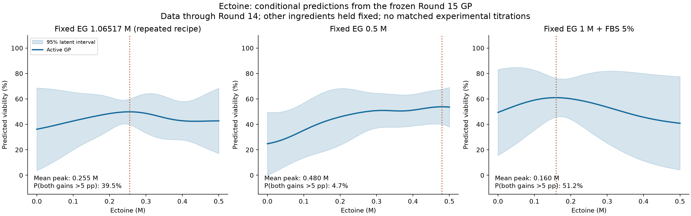
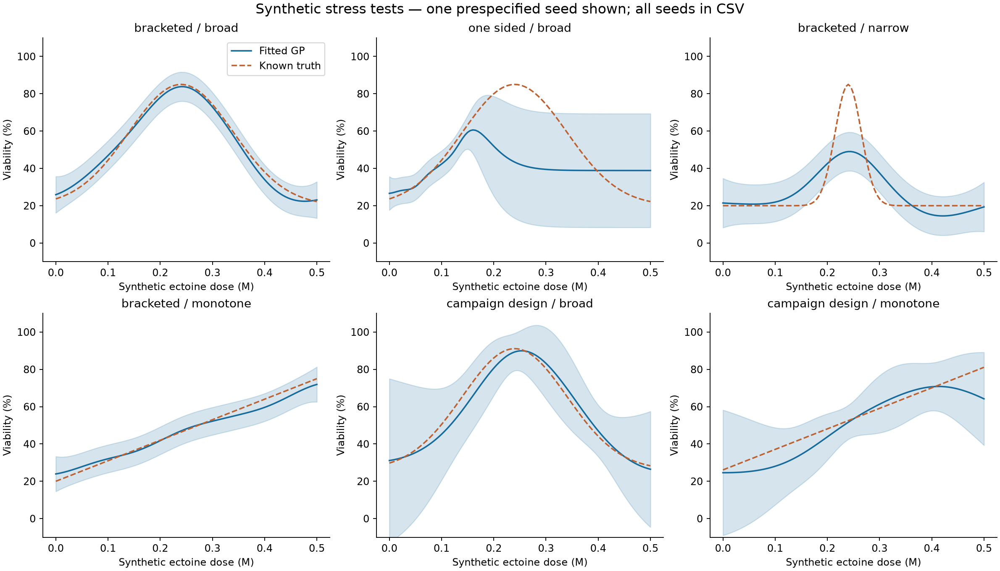
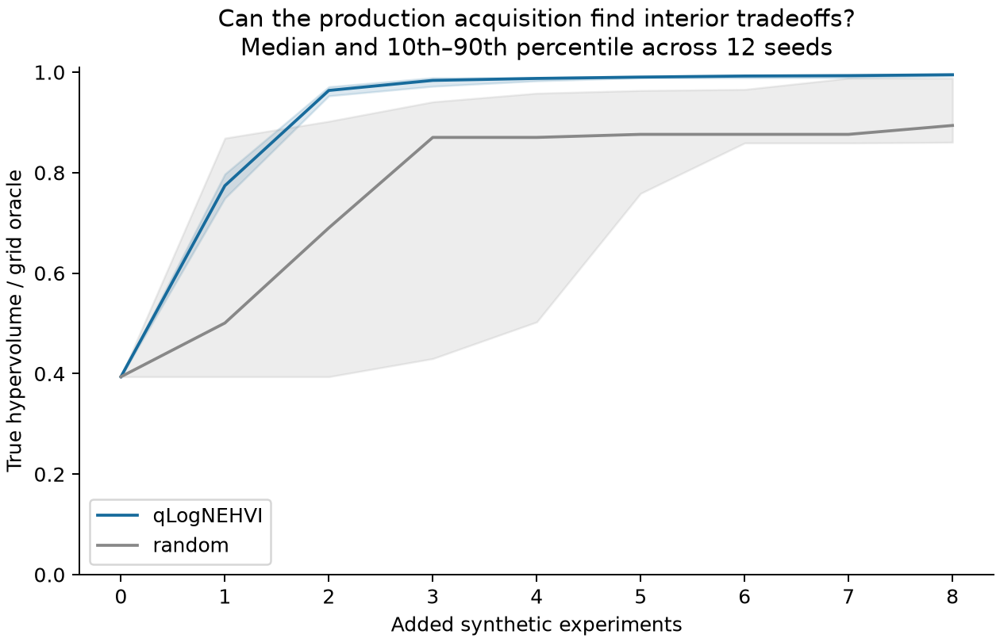

# Dose–response validation, 22 October 2026

The production GP can represent an interior optimum, and its current viability mean already does so for ectoine in several mixtures. The campaign has **not established that optimum with high confidence**. qLogNEHVI uses the GP posterior to select experiments; it does not fit a separate dose–response model. Synthetic experiments using the production implementations confirm that this combination can find an interior optimum when the observations contain enough information.

For a beneficial endpoint such as viability, “too little and too much are bad” produces an **inverted U**. The corresponding damage or loss curve is U-shaped. This is a hypothesis to test per ingredient, mixture and endpoint, rather than a shape to impose on every ingredient.

## What was audited

The immutable GP comparison snapshots for the ROUND_015 proposal, trained through ROUND_014, were loaded and their hashes checked. The active strategy is `control`: campaign-only Matérn-5/2 viability GP with an additive batch effect informed by recurring controls. It has 163 ordinary formulation–batch means, five control means and 24 formulation features. Ectoine appears in 66 formulation–batch observations representing 52 unique recipes. Comparable mechanics has 26 training rows; the acquisition baseline has 26 paired rows, including the designated mechanical-pair viability companion where required by production.

The fitted batch SD is 7.71 viability percentage points and the residual SD is 10.08 points. The ectoine kernel length scale is 0.1371 M. The model standardizes ingredient concentrations and fixes length scales at one standardized unit; it fits batch and residual SDs, but does not optimize ingredient length scales or integrate hyperparameter uncertainty. Matérn covariance permits nonlinear, nonmonotonic responses. A decreasing covariance with distance does **not** require a monotonic dose–response.

The GP posterior and the differentiable BoTorch adapter were numerically checked for agreement in their joint mean and covariance. The acquisition uses this same formulation posterior. The legacy pooled viability GP and four campaign alternatives were also inspected, using their saved snapshots rather than retraining them on later evidence.

## What the active GP has learned about ectoine

Each diagnostic changes ectoine alone on a 0–0.5 M grid with 0.005 M spacing. Every other modeled ingredient is held fixed. Three illustrative backgrounds were evaluated: the most frequently repeated ectoine formulation, selected without looking at its response, and two explicitly specified EG-containing backgrounds. EG means ethylene glycol; FBS is fetal bovine serum.

| Fixed background | Mean-curve maximum | Mean viability at 0 M / maximum / 0.5 M | P(maximum beats both endpoints by >5 pp) |
|---|---:|---:|---:|
| EG 1.06517 M; other modeled ingredients zero | 0.255 M | 36.2 / 49.9 / 42.7% | 39.5% |
| EG 0.5 M; other modeled ingredients zero | 0.480 M | 24.8 / 53.8 / 53.5% | 4.7% |
| EG 1 M + FBS 5%; other modeled ingredients zero | 0.160 M | 49.4 / 61.0 / 40.9% | 51.2% |



The probability is calculated from 4,096 joint latent-posterior draws, preserving covariance between doses. The middle dose is the maximizer of the posterior mean, fixed before drawing. A five-percentage-point margin is an explicit diagnostic choice, not an established biological threshold. These are conditional empirical-Bayes probabilities, not frequentist p-values or probabilities that the entire curve has exactly one turning point. The shaded bands are pointwise 95% latent intervals, not simultaneous bands or future-assay prediction intervals. Monte Carlo error near 50% is approximately 0.8 percentage points.

Across **all 52 observed ectoine backgrounds**, 45 mean curves have an interior maximum. **None** has at least 95% posterior probability of an advantage exceeding five points over both 0 and 0.5 M. The largest such probability is 81.25%. This supports “the model contains plausible mixture-dependent optima,” not “ectoine's optimal dose is known.” In the EG 0.5 M slice the tiny decrease near 0.5 M is especially weak evidence for a biologically important high-dose penalty. No inference about a downturn above the permitted 0.5 M range is justified.

The older pooled GP is more confident in some slices. For EG 1 M + FBS 5%, its mean peak is 0.070 M and the same diagnostic probability is 98.7%, versus 0.160 M and 51.2% for the active GP. Those models pool different sources and use different noise assumptions. Their disagreement is model sensitivity, not independent biological confirmation. The stronger pooled-model probability is not a reason to replace the active model.

The comparable mechanical GP has no interior mean maximum in these three ectoine slices. Its uncertainty is large. Viability curvature cannot be assumed to apply to mechanics.

## What limits the biological interpretation

There are **zero exact background-matched ectoine dose series**, even with only two different doses: whenever ectoine changes, at least one other modeled ingredient also changes. The same is true of the other ingredients under an exact-coordinate comparison. This does not rule out useful approximate neighbors, but it prevents direct isolation of ectoine's effect. The 52 background sweeps are model interventions; most queried mixtures have not been measured.

Repeated recipes also vary substantially. The most repeated ectoine/EG recipe has batch means from 15.96% to 65.56%. Another repeated ectoine/EG recipe changes from 64.00% to 5.82%. A pooled scatterplot of viability against ectoine concentration would mix recipe differences and batch variability.

The saved active-strategy snapshots through Rounds 10–14 place the primary-context mean maximum at 0.360, 0.320, 0.335, 0.320 and 0.255 M. None reaches the 95%/five-point criterion. When each entire round, including its controls, is omitted and the active model is refitted, that maximum spans 0.215–0.320 M; its diagnostic probability spans 29.9–56.5%. The EG 1 M/FBS 5% peak spans 0.150–0.200 M and its probability spans 47.7–55.3%.

For the 66 ectoine-containing observations, leave-one-round-out prediction RMSE is 16.29 percentage points; 61/66 (92.4%) lie within the future-observation 95% intervals, which include batch and residual uncertainty. This is a retrospective held-round assessment, not a forward-only forecast or causal dose-response validation. Existing measurements of the same recipe in another round may remain in training. The frozen-snapshot history, separately, respects chronological cutoffs.

The exploratory ingredient screen uses one outcome-independent representative background per ingredient: the medoid of measured positive-dose recipes after removing the varied coordinate. HSA, FBS and raffinose have illustrative interior mean peaks at 3.26%, 8.4% and 0.147 M, with diagnostic probabilities 86.4%, 56.5% and 49.5%, respectively. None of the 21 ingredients with at least three positive dose levels reaches 95% in its representative slice. These maxima are mixture-specific hypotheses, not recommended concentrations or exhaustive statements about every background. Three ingredients have no campaign positive-dose support.

## Synthetic recovery tests

The production `BatchGP.fit` implementation was run on six scenarios with 30 random seeds each. The broad viability truth is `20 + 65*exp(-0.5*((dose-0.24)/0.10)^2)`. The narrow case has width 0.025 M. The monotonic negative control is `20 + 110*dose`. Every case includes Gaussian batch offsets with SD 8 pp and independent measurement noise with SD 10 pp, close to the fitted campaign values. No curved mean or U-shape constraint is supplied to the GP.

The bracketed design has 11 equally spaced doses from 0 to 0.5 M in each of four batches plus one control per batch. The one-sided design uses the same counts but only doses from 0 to 0.15 M. The campaign-design scenarios retain the actual 168 training coordinates, control flags and batch labels, replace only the labels with known synthetic truth, and add nuisance effects `8*tanh(EG) + FBS_pct`. These are specified test functions, not mechanistic claims about those ingredients.

| Design / truth | Median absolute peak error | Peak within 0.05 M | Confident interior advantage (>5 pp, probability ≥95%) |
|---|---:|---:|---:|
| Bracketed / broad optimum | 0.0075 M | 30/30 | 30/30 |
| Actual campaign coordinates / broad optimum | 0.0100 M | 30/30 | 24/30 |
| One-sided / broad optimum | 0.0850 M | 0/30 | 0/30 |
| Bracketed / narrow optimum | 0.0050 M | 30/30 | 29/30 |
| Bracketed / monotonic | 0 M | 30/30 | 0/30 false positives |
| Actual campaign coordinates / monotonic | 0.0525 M | 15/30 | 0/30 false positives |

The narrow optimum was localized but its curve was less accurately reconstructed: mean curve RMSE 11.85 pp versus 5.41 pp for the broad bracketed curve. One-sided RMSE was 21.32 pp. Also, a monotonic truth on the actual design can yield a spurious interior **mean** maximum through sparse support and mean reversion, even though the uncertainty criterion does not declare it confidently. This is why visual curvature alone is insufficient.



The chart shows the first prespecified seed; summary tables use every seed. Thirty seeds and these six functions do not establish universal performance or a universal false-positive rate. Zero false positives in 30 runs still permits a roughly 9.5% upper one-sided 95% binomial bound under that particular test condition.

## qLogNEHVI validation and interpretation

Twelve seeds compared the production `shared_scores` qLogNEHVI implementation with uniform random sampling from the same 101-dose grid. Both start with doses 0, 0.1, 0.4 and 0.5 M and add eight single-candidate experiments, with an accompanying viability control per new simulated batch. The two maximized synthetic objectives have distinct interior optima: viability at 0.24 M and mechanics at 0.32 M. Mechanics truth is `0.05 + 0.18*exp(-0.5*((dose-0.32)/0.11)^2)` N/needle. Viability residual/batch SDs are 10/8 pp; mechanical observation SD is 0.003 N/needle. Both arms have identical initial observations and the same noise distributions. Their subsequent noise realizations are not explicitly paired.

After eight additions, qLogNEHVI reached a median **99.49%** of the grid's true optimal hypervolume (minimum 99.13%); random sampling reached **89.39%** (minimum 75.00%). It tested within 0.05 M of the viability optimum in **12/12** runs, compared with **7/12** for random. The hypervolume reference is (0, 0), matching the configured acquisition. Evaluation uses the hidden noiseless functions, not the noisy best measurement.



This is a controlled one-dimensional slice using the production surrogate family and acquisition, with q=1 as in finite-pool scoring. It is **not** a replay of the whole 24-dimensional campaign, a general optimizer benchmark, or a validation of the candidate generator, chemistry constraints, similarity gates, slate diversity allocation or intact-formation policy. The mechanics curve and noise are synthetic. Numerical runtime used BoTorch's pure-Python qLogEHVI path because its optional fused C++ cache was unavailable; the acquisition remained qLogNEHVI.

On the real frozen posterior, the raw two-objective acquisition maxima for the three illustrative slices occur at ectoine 0.00, 0.50 and 0.04 M, respectively. These are diagnostic rankings before feasibility and slate rules, **not proposed formulations**. They differ from viability maxima because qLogNEHVI values uncertainty and the mechanical objective as well as viability. An endpoint selection is therefore not evidence that the GP cannot represent an interior viability optimum. Nor is qLogNEHVI specifically designed to prove a dose-response shape; it targets expected Pareto improvement.

## Implication for the project

Keep nonlinear GPs as a valid modeling option. The most direct missing evidence is a bracketed ectoine titration with the other ingredients fixed, crossing both sides of a hypothesized optimum and retaining batch controls and independent preparations. A second fixed background would test interaction dependence. A conceptual range such as 0, 0.1, 0.2, 0.3, 0.4 and 0.5 M covers the modeled domain; it is not an instruction to prepare these mixtures or an approved next-round slate.

Such a targeted shape-learning design would need explicit allocation: the present diversity policy permits at most two recipes with the same active ingredient pair, and at most one with the same larger ingredient combination in a slate. Normal acquisition-driven optimization therefore need not produce a dense fixed-background titration. A separate diagnostic allocation or reviewed policy change would be needed. No campaign configuration or proposal was changed by this audit.

Length-scale optimization, interaction-sensitive model comparisons, or a hormetic challenger could be evaluated by held-round predictive performance, but imposing a universal U-shape would risk creating unsupported optima. The present evidence supports gathering discriminating dose information before declaring a universal ectoine sweet spot.

## Reproduction and evidence

Run from the repository root:

```bash
OPENBLAS_NUM_THREADS=1 VECLIB_MAXIMUM_THREADS=1 python3 research/dose_response/validate_dose_response.py --part all --seeds 30 --bo-seeds 12
```

The script writes audit outputs only; it does not run campaign selection or ingest observations. `actual_summary.json` records source hashes and model provenance. `validation_manifest.json` records runtime versions and final output hashes. Raw rows, all posterior contrasts, history, leave-round-out predictions, synthetic runs and acquisition trajectories are retained beside this report. `ingredient_screen.csv` and `dose_support.csv` cover every active feature. The read-only analysis script lives at `research/dose_response/validate_dose_response.py`.

Method references: [Rasmussen & Williams, covariance functions](https://gaussianprocess.org/gpml/chapters/RW4.pdf); [BoTorch multi-objective optimization tutorial](https://botorch.org/docs/v0.17.2/tutorials/multi_objective_bo); [BoTorch qLogNEHVI API](https://botorch.readthedocs.io/en/stable/acquisition.html#botorch.acquisition.multi_objective.logei.qLogNoisyExpectedHypervolumeImprovement). Project-specific claims above come from the hashed local snapshots, source code and saved audit results.
